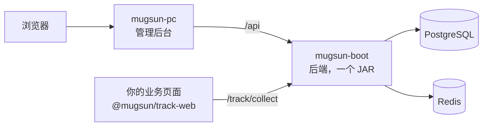

# mugsun

mugsun 是一套可以私有化部署的中后台系统，包含业务后端、管理后台和产品行为分析。

三部分是独立的代码仓库，都部署在自己的服务器上，不依赖公有云服务。

[文档](https://docs.mugsun.com/) | [English](https://docs.mugsun.com/en/) | [快速开始](https://docs.mugsun.com/guide/getting-started)


## 试用

装好 Docker 后执行下面三条命令。后端、管理后台、数据库和 Redis 都在容器里启动。

```bash
git clone https://github.com/mugsun/mugsun-boot.git && cd mugsun-boot
docker compose -f docker-compose.full.yml up -d --build
docker compose -f docker-compose.full.yml run --rm init show
```

最后一条命令打印管理员口令。打开 <http://127.0.0.1:8088>，用 `admin` 登录。

## 仓库



| 仓库 | 说明 |
| --- | --- |
| [mugsun-boot](https://github.com/mugsun/mugsun-boot) | 后端。Spring Boot 3 单体应用，自带账号权限、多租户和工作流 |
| [mugsun-pc](https://github.com/mugsun/mugsun-pc) | 管理后台，用 Vue 3 和 Element Plus 编写 |
| [mugsun-track](https://github.com/mugsun/mugsun-track) | 浏览器埋点 SDK，npm 包名是 `@mugsun/track-web` |
| [mugsun-core](https://github.com/mugsun/mugsun-core) | 后端的公共库，包含 BOM 和两个 Spring Boot Starter |
| [mugsun-docs](https://github.com/mugsun/mugsun-docs) | 文档站 [docs.mugsun.com](https://docs.mugsun.com/) 的源码 |
| [mugsun-start](https://github.com/mugsun/mugsun-start) | 项目生成器，还在开发中 |
| [mugsun-app](https://github.com/mugsun/mugsun-app) | 移动端，目前只有说明文档 |
| [mugsun-skills](https://github.com/mugsun/mugsun-skills) | 给 AI 编程助手用的技能 |
| [mugsun-site](https://github.com/mugsun/mugsun-site) | 官网入口，暂时跳转到文档站 |

uni-app x 组件库的[文档](https://docs.mugsun.com/uniappx/)已经开放，源码仓库暂未公开。

除 mugsun-site 外，上表的仓库都使用 MIT 许可。

## 适合什么项目

| 适合 | 不适合 |
| --- | --- |
| 需要私有化交付、数据不能出内网的中后台项目 | 拖拽生成页面、不写代码的低代码平台 |
| 既要管理后台又要行为分析，不想再接一套公有云分析服务 | 只需要纯前端模板、不需要后端的项目 |
| 要求人大金仓、达梦数据库或国密算法的项目 | 现在就需要拆分成微服务的项目 |

## 参与贡献

贡献指南、安全问题的报告方式和 Issue 模板都在 [mugsun/.github](https://github.com/mugsun/.github)。
